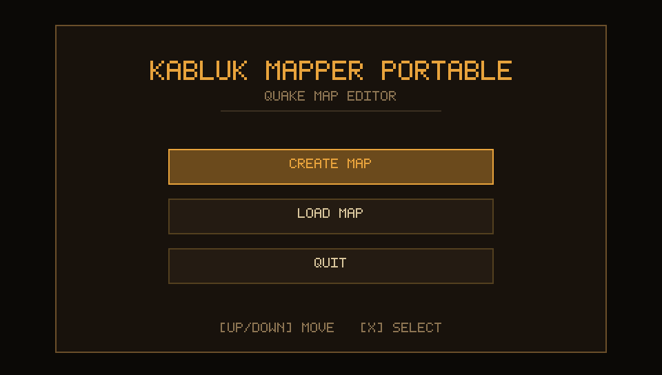
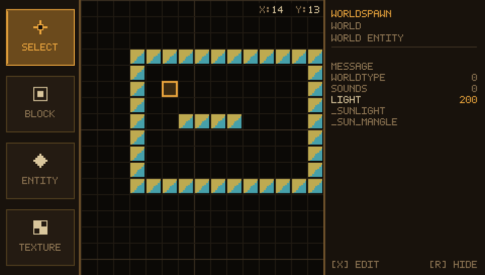
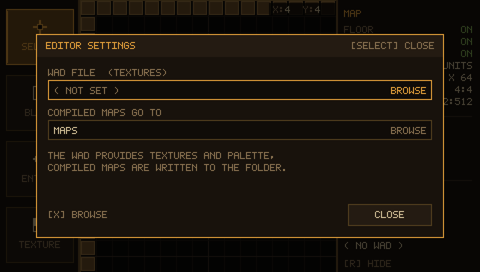
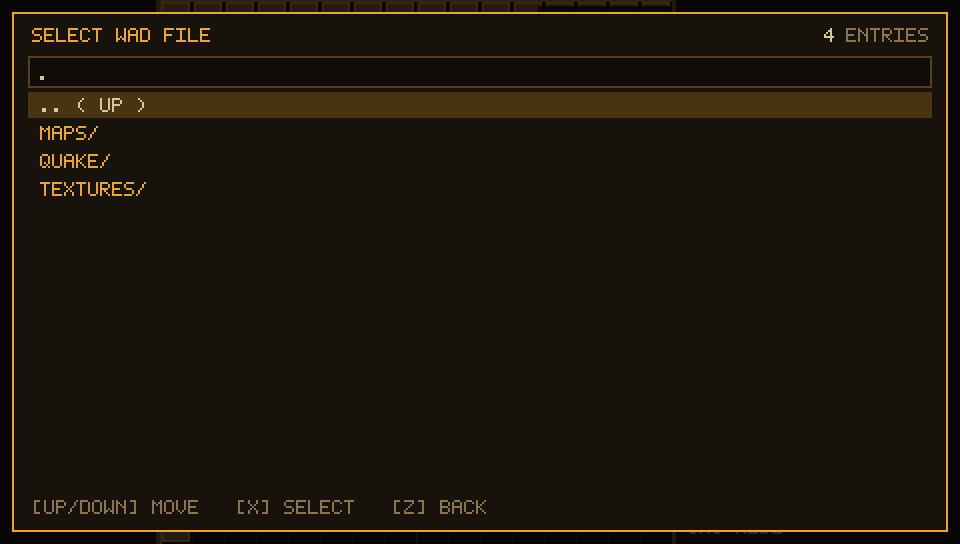

# Kabluk Mapper Portable

A small Quake map editor with a hand drawn interface: no widgets, no toolkit,
just rectangles and a 5 x 7 bitmap font on top of SDL2. It was written for a
480 x 272 screen, which is exactly what the PSP has - the same sources run in
a window on Windows and build for the handheld with the Makefile in this
repository.



## What it does

* **A grid of blocks.** 32 x 32 cells of 128 units each; a cell holds a solid
  block or nothing, and each block remembers the texture of its top face.
* **Four tools.** `SELECT`, `BLOCK`, `ENTITY`, `TEXTURE` down the left panel
  (or `1`..`4`), a click in the grid applies the current one.
* **A property panel.** The world's keys, the selected block's texture, the
  entity's `classname` and every key the `.fgd` gives that class. Values are
  edited on an on-screen keyboard.
* **Real compiling.** `qbsp`, `light` and `vis` are vendored (`vendor/tyrutils`)
  and run in order from the compile window (`F2`), with their logs and the
  `.bsp` / `.prt` written next to the `.map`.
* **Loading back.** The editor's own output reopens: brushes become cells,
  point entities come back with their keys, and the settings follow the file.
* **A settings window** (`ENTER`) for the wad, the output folder, the map name
  and the slab textures - see [docs/settings.md](docs/settings.md).

| start screen | loaded map | settings | texture browser |
| --- | --- | --- | --- |
|  |  |  |  |

## Building

### Windows / desktop

`KablukMapperPortable.vcxproj` (Visual Studio) or, with a system SDL2:

```sh
gcc -O2 -std=gnu99 -o kabluk KablukMapperPortable/*.c vendor/tyrutils/*/*.c \
    $(sdl2-config --cflags --libs) -lm
```

### PSP

`pspdev` (tested against `pspdev-win-15.2.0-v2` at `C:\pspdev`, which ships
SDL2) plus the Makefile in the repo root:

```sh
export PSPDEV=/c/pspdev
export PATH=$PSPDEV/bin:$PATH
make          # -> EBOOT.PBP
make dist     # -> dist/PSP/GAME/KABLUK/, ready for the Memory Stick
```

The full walkthrough - what the flags are for, the folder layout on the card,
the pad controls and the limits of the PSP renderer - is in
**[docs/psp-build.md](docs/psp-build.md)**.

## Controls

| desktop | PSP | what it does |
| --- | --- | --- |
| arrows | D-pad | move the cursor, walk lists |
| `X` | cross | confirm / pick / press |
| `Z`, `ESC` | circle | cancel, and leave the editor for the start screen |
| mouse | nub + `□` | pointer, and the click at that point |
| `Q` / `E` | `L` / `R` | fold the tool / property panel |
| `F` | triangle | jump into the property panel |
| `ENTER` | `SELECT` | settings |
| `F2` | `START` | compile window |
| `N` | - | new folder in the file browser |

`ESC` never closes the program: the start screen with `CREATE MAP` /
`LOAD MAP` / `QUIT` is the way in and out.

## Documentation

* [docs/main-menu.md](docs/main-menu.md) - the start screen, credits, and what
  a loaded `.map` restores
* [docs/settings.md](docs/settings.md) - the settings window and the exporter
* [docs/compile-chain.md](docs/compile-chain.md) - qbsp / light / vis, the
  vendored sources and what the compile window reports
* [docs/properties.md](docs/properties.md) - the property panel and the `.fgd`
* [docs/psp-build.md](docs/psp-build.md) - building and running on the PSP

## Layout of the sources

| file | what lives there |
| --- | --- |
| `main.c` | the app loop, event handling, teardown; `app_quit` and the PSP chdir |
| `input.c` | pad -> key/mouse translation (the PSP has no keyboard) |
| `menu.c` | the start screen and the corner credits |
| `grid.c`, `ui.c` | blocks, the tool panel, the palette |
| `props.c`, `fgd.c` | the property panel and `.fgd` parsing |
| `mapfile.c` | reading a `.map` back into the editor |
| `compile.c`, `compileui.c`, `bspchain.c` | the exporter and the compile window |
| `wad.c`, `textures.c` | wad reading, palette, block previews |
| `gfx.c`, `font.c` | the drawing layer and the 5 x 7 font |
| `fs.c`, `picker.c`, `settings.c`, `keyboard.c` | folders, the file browser, settings, text entry |
| `config.h`, `keys.h` | every constant and every key binding |

The editor itself is C89 clean, allocates nothing per frame and uses no
threads; `vendor/tyrutils` is the original C99 code, built with `-w`.
