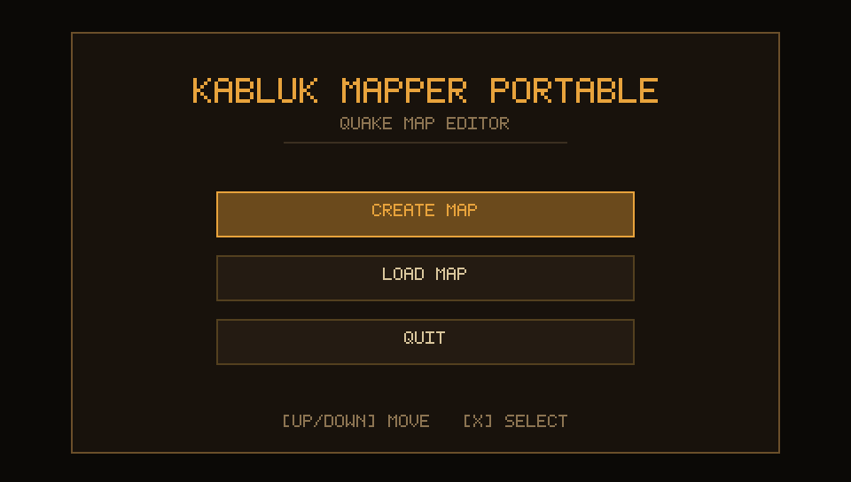
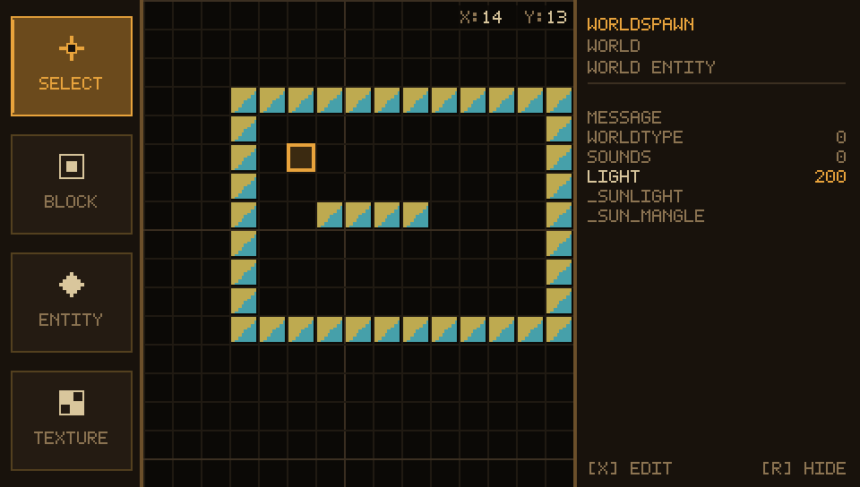

# The start screen



The editor boots into the start screen instead of an empty grid. Three buttons,
up / down (or the mouse) moves the highlight, `X` (cross) takes it:

| button | what happens |
| --- | --- |
| `CREATE MAP` | the empty project is thrown away and the editor opens on a blank grid |
| `LOAD MAP` | opens the file browser filtered to `.map`, and loads the file that is picked |
| `QUIT` | back to the XMB on the PSP, the window closes on Windows |

`Z` (circle) goes back to the map that was being edited, when the start
screen was opened from the editor (the `MAIN MENU` button in the settings, or
`ESC`). Nothing is thrown away: create, load and save all keep working the
same, the map is still there when the screen closes.

On a fresh start there is nothing to go back to, so `Z` does nothing there and
the only ways forward are `CREATE MAP` or `LOAD MAP`.

Under the panel the two corners carry the credits: `DIMTENCORP` on the left,
`VERSION 0.1` on the right. Both strings live in `config.h` (`APP_AUTHOR`,
`APP_VERSION`), so bumping the version is a one line change.

`ESC` inside the editor now **returns to the start screen** instead of closing
the program - that is where `QUIT` lives. On the PSP, where there is no `ESC`,
the `MAIN MENU` button of the settings window does the same, and circle brings
the map back.

## Loading a `.map`



`LOAD MAP` opens the same browser the settings window uses, starting in the
folder compiled files go to (`COMPILED FILES GO TO`), and only shows `.map`
files and folders. `N` still creates a folder, `Z` goes back to the start
screen, up / down / `X` walk and pick.

The file is read back into an editor whose grid is 32 x 32 blocks of 128 units,
so:

* **the wad** comes from worldspawn's `"wad"` key (see `mapfile_peek_wad`). The
  path is tried as written, then next to the `.map`, then one folder above it;
  when a different wad was in use it is loaded before the textures are looked
  up. Textures are matched case insensitively - a missing one falls back to the
  first texture of the wad, exactly like the exporter's own fallback.
* **the blocks** are recovered by testing the centre of every cell against the
  planes of each brush, at the middle height of a cell. Anything solid there
  turns that cell on, which is how the floor and ceiling slabs (they sit
  outside that plane) stay out while the blocks themselves come back. The cell takes the texture of the brush's up facing
  face, or of its first face when it has none.
* **point entities** are placed where the fgd class named in `classname` is
  known and the entity has an `origin`; every other key of the entity (and all
  of worldspawn's, `wad` included) is stored in the property panel, so
  `light`, `message`, `angle` and friends survive the round trip.
* **the map name and folder** in the settings follow the file that was loaded,
  so `SAVE .MAP` and `COMPILE MAP` write next to the source that was opened
  instead of silently using the old name.

A quick round trip of the editor's own output:

```
load maps/kabluk.map   -> 21 brushes, 166 cells
COMPILE MAP            -> kabluk.bsp 443 435 B   (the same map compiled by hand: 443 458 B)
```

### When the file cannot be read

The browser stays open and the line under the list says why, for example:

```
LOAD FAILED: BROKEN .MAP FILE
```

Nothing is written to disk by a load, so picking another file is always safe.

### What is not restored

The exporter writes only what qbsp needs: the surfaces of the solid cells. A
fully enclosed hollow of blocks has no surface of its own, so it comes back
empty; every block that touches open space comes back solid. Point entities
outside the 32 x 32 grid are clamped to its edge, like the cursor is.
