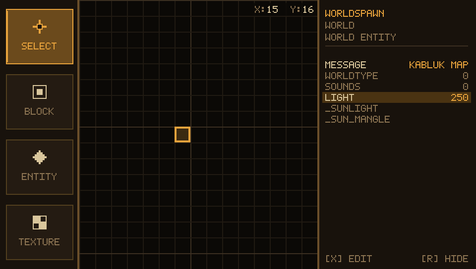
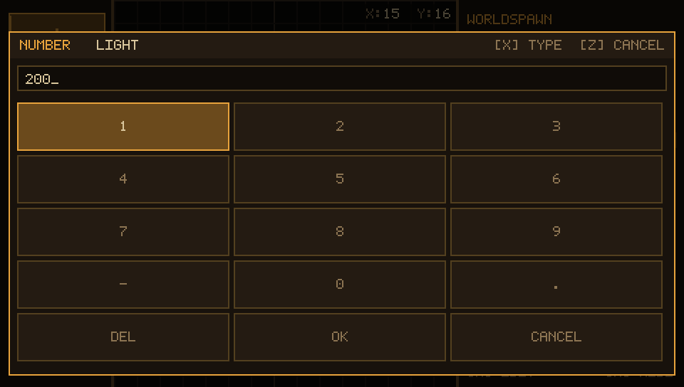
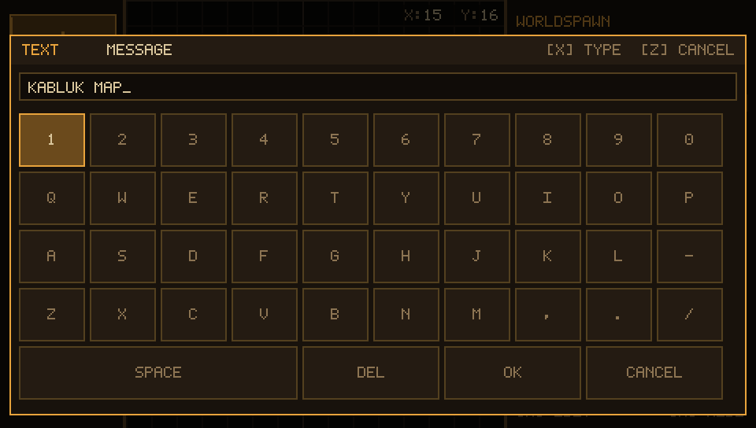

# The right panel is an editor



The right panel lists the `.fgd` properties of whatever is selected: an entity
when the SELECT tool has one, worldspawn when nothing is selected. Values that
came from the `.fgd` are dim, values **you** typed are drawn in the accent
colour, so a glance tells you what this map changes.

Every row can be edited, and both the entity keys and worldspawn's keys end up
in the `.map` the compiler reads.

## Opening a property

| | mouse | keys |
| --- | --- | --- |
| focus the panel | click a row | `F` (= `KEY_PROP_FOCUS` in `keys.h`) |
| move through the rows | hover | up / down (the list scrolls to follow) |
| edit the highlighted row | click it | `X` (confirm) |
| leave the panel | click the grid | `Z` (cancel) |

`Z` inside the panel only drops the focus back to the map, it does not undo
anything. A run of `CANCEL` in the keyboard throws the typed value away.

## Which keyboard you get

`props_is_numeric()` looks at the `.fgd` type of the row — case insensitive,
because the shipped `Quake.fgd` says `Flags`, not `flags`:

| `.fgd` type | keyboard |
| --- | --- |
| `integer`, `flags`, `choices`, `shootable` | **numpad** — `123 / 456 / 789 / -0.` |
| anything else (`string`, `color255`, `target_source`, ...) | **full keyboard** |





The layouts are four plain strings in `keyboard.c` (`1234567890/QWERTYUIOP/
ASDFGHJKL-/ZXCVBNM,./` and `123/456/789/-0.`), so adding a key is adding a
character, and the navigation code never learns about columns.

## Using the keyboard

| action | keys | mouse |
| --- | --- | --- |
| move the cursor | arrows | hover |
| type the highlighted key | `X` | click it |
| delete the last character | `BACKSPACE` | `DEL` |
| save the value | `ENTER` (START) or `OK` | `OK` |
| throw it away | `Z` (circle) or `ESC` | `CANCEL`, or a click outside |

On the desktop every printable key of the real keyboard is accepted too and is
inserted directly (`a`–`z` are stored lowercase, `X` and `Z` stay reserved for
confirm / cancel). Characters a layout does not contain — a value like
`monster_army` outside the numpad, or a `"` — are simply not accepted.

## Where the value lives

`values.c` is a fixed pool of 512 `{cell, key, value}` entries — no `malloc`
(PSP rule), about 50 KB of static memory. An entry belongs either to a map cell
that holds an entity, or to worldspawn, which is the pseudo cell **-1:-1** —
the same "nothing selected" state the panel already uses.

```
values_set(&values, cx, cy, "targetname", "door1");
```

Setting an empty value deletes the override, so the row falls back to the
`.fgd` default. Erasing an entity (right click / `Z` with the ENTITY tool)
clears its values, and so does placing a **different** class in the same cell —
keys typed for the old class would not mean anything to the new one. Placing
the same class again keeps them, so you can move an entity without retyping.

## What reaches the `.map`

`compile.c` runs once per frame; step 3 writes worldspawn, step 5 writes one
block per point entity:

```
{
"classname" "worldspawn"
"message" "Kabluk map"
"light" "250"
}
{
"classname" "info_player_start"
"origin" "-1920 -1920 24"
"angle" "90"
"targetname" "start1"
}
```

* `classname` and `origin` are computed by the editor and never taken from the
  pool; `origin` is `cell*128 - 2048 + 64` with `z` 24.
* only what you typed is written — an untouched row falls back to the `.fgd`
  default in the panel, and is not exported at all.
* worldspawn's `light` is the map wide minlight the `light` tool reads (see
  `compile-chain.md`); the editor seeds it with `DEFAULT_MINLIGHT` (200) when
  the map is new, and from then on the row is yours.

Changing `light` to `250` in the panel and compiling gives the same log line
with the new number:

```
WORLDSPAWN LIGHT: 250 (MINLIGHT)
```

## Limits worth knowing

* 512 key/value pairs per session — a few hundred entities with a handful of
  keys each.
* the 5x7 bitmap font is uppercase only, so a value shows as `KABLUK MAP` even
  though lower case is what is stored and what the `.map` contains.
* `(list)` is not a value: a `choices` property whose `.fgd` default is
  `(list)` opens with an empty field.
