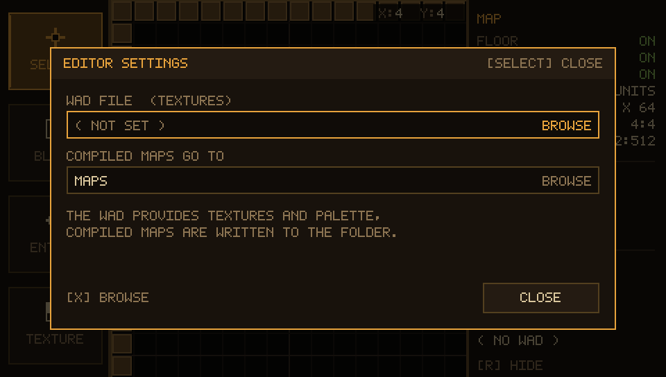
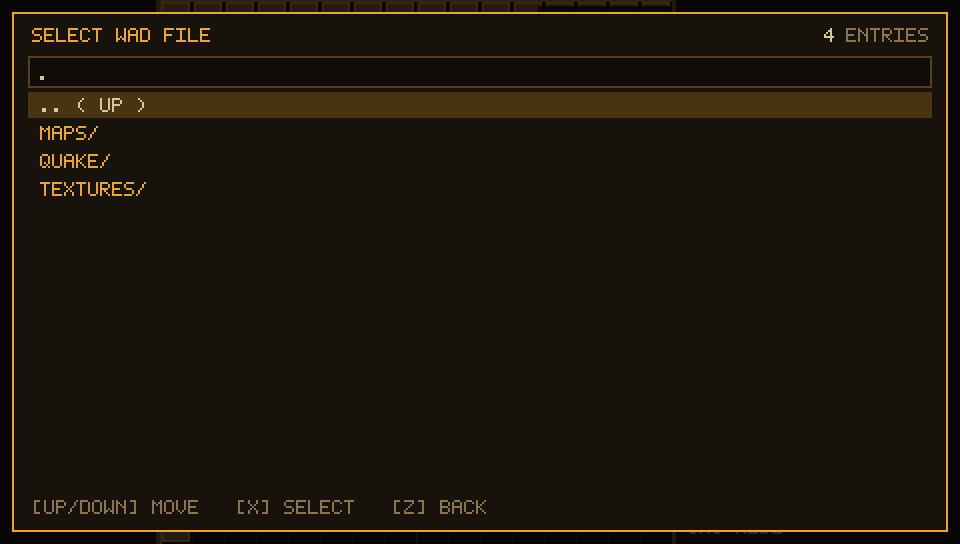

# Editor settings



`ENTER` (PSP: `SELECT`) opens the settings window, `Z` / `ESC` closes it.
Up / down walks the rows, `X` (or a click) does what the row says. Every row
shows what it will do on its right edge: `BROWSE`, `TYPE`, `PICK`.

| row | what it holds |
| --- | --- |
| `WAD FILE (TEXTURES)` | the `.wad` the block textures come from |
| `COMPILED FILES GO TO` | folder for `kabluk.map`, `.bsp`, `.prt` and the logs |
| `MAP SOURCE NAME (.MAP,.BSP)` | the name of the map, without the extension |
| `FLOOR TEXTURE` | texture of the floor slab the exporter writes |
| `CEILING TEXTURE` | texture of the ceiling slab |
| `SAVE .MAP` | writes **only** the `.map` source to that folder |
| `MAIN MENU` | shows the start screen; the map stays loaded, circle goes back to it |
| `CLOSE` | back to the editor |

## The map name and the folder

The exporter writes `<folder>/<name>.map`; qbsp then puts `<name>.bsp`,
`<name>.prt` and `<name>.log` next to it. `COMPILE MAP` (F2 window) uses the
same pair of settings, so a compile and a save always agree on the path.

The name is sanitised before it reaches the filesystem: path separators,
`:` and anything Windows rejects become `_`, trailing dots and spaces are
dropped (`my/room` → `my_room`). An empty field falls back to `kabluk`.
A missing output folder is created when the map is written.

`SAVE .MAP` is the "save the source" button: it runs the exporter and stops
before `qbsp`/`light`/`vis`, so the text `.map` is on disk in a moment and the
result line under the buttons shows the file it wrote:

```
MAPS/MYROOM.MAP
```

## Floor and ceiling textures

Both slabs are chosen from the loaded `.wad` with the same picker the
`TEXTURE` tool uses: a grid of square cells, the texture on top and its name
underneath, nine cells across and four down (36 per page). The arrows walk the
grid — left / right by one cell, up / down by a row, and the page follows the
selection — cross confirms, circle closes. An empty setting means "first
texture in the wad", which is what every map used before it existed.

The thumbnails are built from a mip level picked to fit the cell (a 64 x 64
texture is shown from its 32 x 32 level) and only the **centre square** of it
is drawn, so every cell is a square swatch of its texture and nothing is
stretched: a 32 x 64 texture shows its middle 16 x 16 instead of being
squashed into a square or shown as a thin sliver. On the PSP the square is
rounded up to a power of two *after* the crop (`24 x 24` goes up as
`32 x 32`), which is what keeps the pixels square - rounding first stretched
one axis only. The thumbnails go through a 48 entry least-recently-used cache,
so a wad with hundreds of textures costs the same memory as a page of them.

A block in the editor grid is drawn the same way, from a 16 px mip - one
texture pixel per screen pixel - and the block cells are 16 px, so what you
see on the grid is the texture, not an 8 x 8 mip blown up five times.

Both **WAD2** (Quake) and **WAD3** (Half-Life) wads are read. They share the
header and the 40 byte `miptex_t`, but Quake run-length encodes each mip level
and Half-Life stores it as raw 8-bit pixels; decoding a WAD3 as runs turns
every texture into smears. `SDL_Log.txt` names the kind it found
(`WAD loaded: 236 textures, WAD2, palette found`), as does the first texture's
size, which is what to send with a report about how a texture looks.

If the **palette** is missing every texture comes out as a grey ramp — a wad
does not carry one, it is `gfx/palette.lmp` from the game, and the reader looks
for it (and for a `palette` / `PALETTE` lump, in any capitalisation) next to
the wad and one and two folders above. When none is found the picker says so
in its footer instead of leaving you wondering.

The same floor texture is used for the sealing walls the exporter adds around
the border of the map (see `compile-chain.md`), so a map built without any
wall of its own still looks finished.

## The file browser can create folders



`NEW FOLDER` (or `N`) asks for a name on the on screen keyboard
(`docs/properties.md` has the keys) and creates it inside the folder that is
open. The list, the entry counter and the path field refresh right away, so
the new folder can be entered or picked as the output folder immediately.

## The settings are kept in `kabluk.cfg`

Everything on this window - the wad, the output folder, the map name and the
two slab textures - is written to **`kabluk.cfg`** next to `EBOOT.PBP` (next to
the executable on the desktop) as soon as it changes, and read back at
startup. So picking a floor texture in the picker and quitting no longer means
picking it again tomorrow:

```
# Kabluk Mapper Portable - editor settings
# written by the editor when something here changes
wad=ms0:/PSP/GAME/KABLUKmp/quake.wad
out=ms0:/PSP/GAME/KABLUKmp/maps
name=qwe1
floor=brown
ceiling=sky1
```

The file is plain text and one `key=value` per line: `#` starts a comment, an
unknown key is ignored (so a newer build's file does not stop an older one
from starting), and a value keeps everything after the first `=` - the paths
on a PSP are full of `:` and `/`. A missing or half-written file just means
the defaults (`maps`, `kabluk`, first texture of the wad) are used. Delete it
to get those defaults back.

The browser is used for three things: the `.wad`, the output folder
(`( USE THIS FOLDER )` confirms the folder you are in) and nothing else — it
never deletes or renames anything.

On the PSP the output folder browser starts on `ms0:/`, the root of the
memory stick: the editor itself runs from `ms0:/PSP/GAME/KABLUK` and every
relative path in the settings lives there, but `.. ( UP )` climbs out of the
EBOOT folder, all the way to `ms0:/`, where it stops. Once a folder has been
picked it is opened again next time, and `( USE THIS FOLDER )` stores its full
path (`ms0:/PSP/GAME/MYMAPS`), so a card can be laid out the way its owner
wants instead of being tied to the EBOOT folder.

## What is written into the `.map`

The exporter remembers the `.wad` in the worldspawn entity:

```
"wad" "./tex.wad"
```

`qbsp` would look for that file next to the `.map`, which is not where the
editor keeps it, so the compile chain also passes `-wadpath <that folder>`.
Without it every texture came back as `Texture ... not found` and the `.bsp`
shipped without a single miptex; now the level carries the textures it shows
in the editor.
